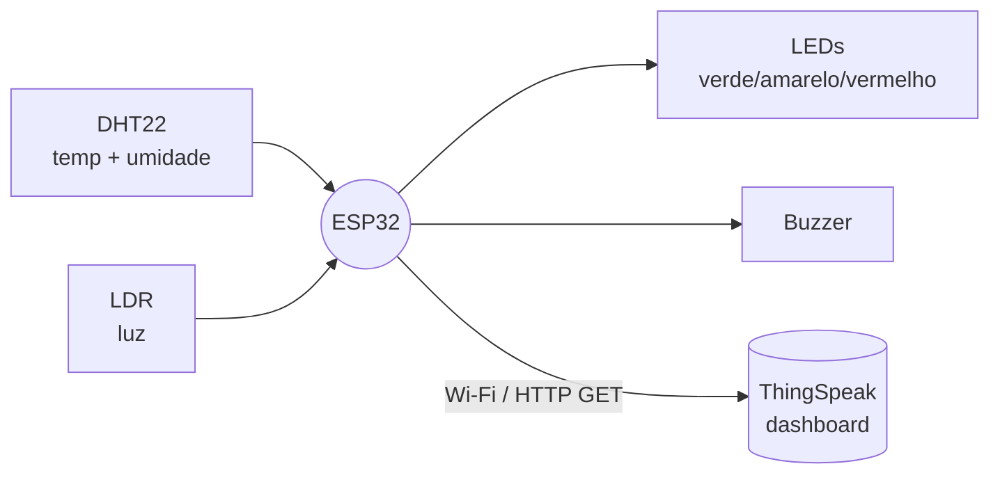
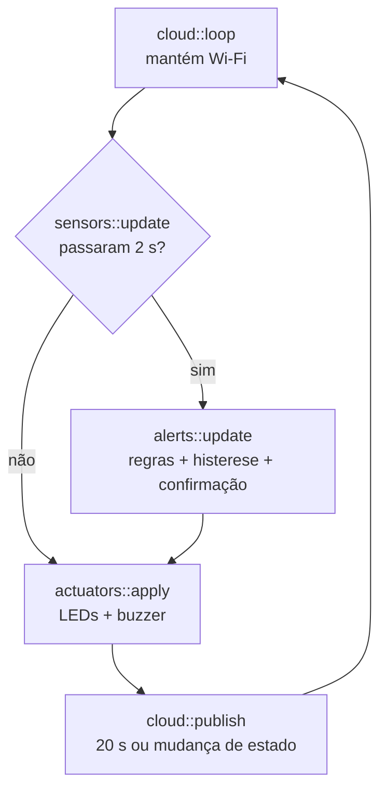

# Arquitetura

## Visão geral



## Fluxo do `loop()`



## Módulos

| Módulo | Entrada | Saída | Observações |
|---|---|---|---|
| `sensors` | GPIO 32 (DHT22), GPIO 34 (LDR) | `Reading` | Média de 16 leituras do LDR; descarta valores fora da faixa física do DHT22; 3 falhas seguidas = falha de sensor |
| `alerts` | `Reading` | `AlertResult` | Máquina de estados com histerese e confirmação |
| `actuators` | `AlertLevel` | LEDs/buzzer | Buzzer por `millis()`, sem `delay()` |
| `cloud` | `Reading` + `AlertResult` | HTTP GET | Envio periódico, por mudança de estado e *backoff* |

## Decisões de projeto

| Decisão | Motivo |
|---|---|
| LDR no GPIO 34 (ADC1) | O ADC2 é inutilizado pelo Wi-Fi no ESP32 |
| Histerese + confirmação de 2 leituras | Evita alarme intermitente por ruído ou valor na fronteira |
| Amostragem a cada 2 s | Limite mínimo do DHT22 |
| Envio a cada 20 s | ThingSpeak gratuito aceita 1 envio a cada 15 s |
| Envio imediato em mudança de estado | O dashboard reflete um alarme sem esperar o ciclo |
| *Backoff* exponencial (5 s → 60 s) | Não insistir em um servidor/rede com problema |
| Campos omitidos em falha do DHT22 | Não enviar dado velho como se fosse atual |
| Credenciais em `secrets.h` | Chave fora do repositório |
| Compatibilidade core 2.x/3.x | A API LEDC mudou; o `actuators.cpp` trata as duas |

## Máquina de estados

```
          (≥2 leituras fora da faixa ideal)        (≥2 leituras fora da faixa crítica)
   OK ───────────────────────────────────▶ ATENÇÃO ───────────────────────────────────▶ CRÍTICO
    ▲                                         │  ▲                                          │
    └───── (≥2 leituras dentro da faixa ──────┘  └──── (≥2 leituras recuando a margem ─────┘
            ideal, com folga da histerese)             de histerese)
```

Falha do DHT22 leva a **ATENÇÃO** (motivo: falha de sensor).
